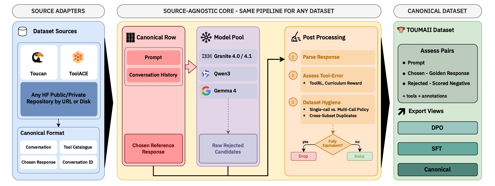

# TOUMAII-Gen

**TOUMAII-Gen** converts tool-calling demonstrations into reference-scored preference pairs for direct
preference optimization (DPO). It supports Toucan, ToolACE, and existing canonical or DPO datasets.
A lightweight source adapter can add support for another dataset.

[Project page](https://tum-ai.github.io/toumaii-gen/) · [Paper on arXiv](https://arxiv.org/abs/2611.26722) · [Hugging Face collection](https://huggingface.co/collections/tum-ai/toumaii-generated-datasets-6ae48f51f5d7bb870b417cc0)

Accepted to the [NeurIPS 2026 AABA4ET Workshop](https://marscod.github.io/AABA4ET.NeurIPS.2026/accepted-papers.html).



*TOUMAII-Gen overview, Figure 1 in the paper. Source adapters convert demonstrations into a shared format. The generator produces alternatives, then scores and filters the resulting pairs for canonical, DPO, and SFT export.*

## Released datasets

[TOUMAII-Toucan](https://huggingface.co/collections/tum-ai/toumaii-toucan-6ae37226be696553bf45f1a5) contains **4,515,503** preference pairs from quality-filtered
[Toucan-1.5M](https://huggingface.co/datasets/Agent-Ark/Toucan-1.5M) trajectories. Applying the same pipeline to
[ToolACE](https://huggingface.co/datasets/Team-ACE/ToolACE) yielded **100,846** additional pairs in TOUMAII-ACE.

| Release | Hugging Face dataset ID | Preference pairs |
| --- | --- | --- |
| [TOUMAII-Toucan · Kimi-K2](https://huggingface.co/datasets/tum-ai/toumaii-toucan-kimi) | `tum-ai/toumaii-toucan-kimi` | 1,369,232 |
| [TOUMAII-Toucan · OSS](https://huggingface.co/datasets/tum-ai/toumaii-toucan-oss) | `tum-ai/toumaii-toucan-oss` | 1,734,057 |
| [TOUMAII-Toucan · Qwen](https://huggingface.co/datasets/tum-ai/toumaii-toucan-qwen) | `tum-ai/toumaii-toucan-qwen` | 1,412,214 |
| [TOUMAII-ACE](https://huggingface.co/datasets/tum-ai/toumaii-toolace) | `tum-ai/toumaii-toolace` | 100,846 |

Each pair keeps the conversation context and tool definitions alongside a reference response and a
model-generated alternative. For example, a candidate may call the correct price lookup with
`vs_currency="USD"` where the tool schema expects `"usd"`. See the
[interactive examples](https://tum-ai.github.io/toumaii-gen/#examples) for more cases and their ToolRL rewards.

### Quickstart

Stream or load a release with Hugging Face `datasets`:

```python
from datasets import load_dataset

# TOUMAII-Toucan: choose a generator config (gemma4_E2B, granite4_350m,
# granite4_1b, granite4_3b, qwen3_0.6B, qwen3_1.7B) and an interaction split
# (singleturn_singlecall, singleturn_multicall, multiturn_singlecall, multiturn_multicall)
ds = load_dataset(
    "tum-ai/toumaii-toucan-qwen",
    "gemma4_E2B",
    split="singleturn_singlecall",
    streaming=True,
)

# TOUMAII-ACE: uses the "default" config and "train" split
ace = load_dataset("tum-ai/toumaii-toolace", "default", split="train", streaming=True)
```

## Repository layout

- [`config.yaml`](config.yaml) defines the source, generation backend, and outputs.
- [`config.toolace.yaml`](config.toolace.yaml) runs the same pipeline on ToolACE instead of Toucan.
- [`tool_calling_data_generation/`](tool_calling_data_generation/) contains source adapters,
  Transformers and vLLM generation backends, scoring, and export.
- [`tests/`](tests/) covers the generator and its integrations.

## Install

The ML stack depends on your accelerator. Each is a separate extra in
`pyproject.toml`, and `[tool.uv] conflicts` keeps uv from unifying them.

| Environment | Install | Stack |
| --- | --- | --- |
| CPU (any platform) | `uv sync --extra trl` | Transformers 5.10.2 + CPU Torch 2.11.0, no vLLM |
| NVIDIA CUDA (Linux) | `uv sync --extra vllm` | vLLM 0.22.1 + Torch 2.11.0 from PyPI |
| AMD ROCm 7.2.2 (Linux x86_64) | `uv sync --extra vllm-rocm` | vLLM 0.22.1 + AMD Torch/triton wheels |
| Apple Silicon (macOS 15+) | `uv sync --extra vllm-metal` | vLLM 0.33.0 + vllm-metal 0.33.0 (MLX) |

Run these from this directory with [`uv`](https://docs.astral.sh/uv/), and add
`--extra dev` for `pytest` and `ruff`. `uv run` resynchronizes the environment,
so repeat the same extra on every command (`uv run --extra trl tool-data-gen …`)
or activate the environment once with `source .venv/bin/activate`.

Notes:

- The `trl` extra is the plain Transformers backend used when vLLM is absent; it
  needs no CUDA/ROCm runtime and runs on CPU.
- The `vllm` and `vllm-rocm` extras only install their stack on Linux; use
  `vllm-metal` on Apple Silicon.
- `vllm-metal` pins Torch 2.14.0, the version vLLM 0.33.0 itself requires.
  Upstream's installer additionally moves Torch to a nightly build for its
  experimental PyTorch path (`VLLM_METAL_BACKEND=mps`); the default MLX backend
  used here does not need it.
- The ROCm index points at the vLLM 0.22.1 / ROCm 7.2.2 wheel tree. For another
  driver, change `vllm-rocm722` in `[[tool.uv.index]]` to the matching
  `https://wheels.vllm.ai/rocm/<vllm-version>/<rocm-build>/` index.

## Generate locally

Review `config.yaml`, especially the model, output path, and Toucan sample
count. For a quick local check, temporarily set `source.toucan.size` to a small
number such as `2`.

```bash
uv run --extra trl tool-data-gen validate --config config.yaml
uv run --extra trl tool-data-gen generate --config config.yaml
```

Swap `trl` for the extra you installed. Each run creates a timestamped directory
under the configured output root with `canonical`, `dpo`, and `sft` Parquet
files, optional JSONL/CSV previews, and `manifest.json`.

## Upload to a private Hugging Face organization

Set `hub.repo_id` in `config.yaml` to `<organization>/<dataset>`. Authenticate
outside the config with `hf auth login` or `HF_TOKEN`, then upload one exact
local run:

```bash
uv run tool-data-gen upload \
  --config config.yaml \
  --manifest outputs/toucan/<run-id>/manifest.json \
  --confirm-private-upload
```

Upload is separate from generation. The command rejects credentials in YAML,
requires `hub.private: true`, checks organization access, refuses a public
target, and verifies privacy after upload.


## Post-process generated datasets

The ToolACE cleaner can run independently of the generation command.

No repository coordinates or commit revision are stored in the source tree.
Before each run, set all three required values in the environment:

```bash
export TOUCAN_CLEANING_SOURCE_DATASET_ID="<owner>/<source-dataset>"
export TOUCAN_CLEANING_SOURCE_REVISION="<40-character-commit-SHA>"
export TOUCAN_CLEANING_DESTINATION_DATASET_ID="<owner>/<destination-dataset>"
```

The command fails before any Hub access if one is absent. Then review the
dataset jobs, drop reasons, and long-value threshold in
`tool_calling_data_generation/post_processing/post_process_rejected.py`. Start
safely with:

```python
DROP_ROWS = False
PUSH_TO_HUB = False
DELETE_TEMPORARY_WORK_DATA = False
```

Then run it from the repository root:

```bash
uv run python -m tool_calling_data_generation.post_processing.post_process_rejected
```

The dry run still downloads and inspects every source Parquet shard, but writes
and uploads nothing. Allow enough temporary space; optionally set
`TOUCAN_CLEANING_TEMP_DIR` to a scratch directory. Only enable row dropping and
Hub upload after reviewing all warnings and counts, and authenticate first with
`hf auth login`.

## Citation

If you use TOUMAII or TOUMAII-Gen, please cite the paper.

```bibtex
@misc{poetzsch2026toumaii,
  title         = {{TOUMAII}: A {4.5M}-Pair Tool-Calling Preference Dataset
                   and Its Source-Agnostic Generator},
  author        = {P{\"o}tzsch, Moritz and Gentilini, Andrea and Rossgoderer, Lisa and
                   Osterfeld, Tom and Arul, Kesava Prasad Sanjivi and Kadhe, Swanand Ravindra},
  year          = {2026},
  howpublished  = {arXiv preprint arXiv:2611.26722},
  eprint        = {2611.26722},
  archivePrefix = {arXiv},
  primaryClass  = {cs.AI},
  doi           = {10.48550/arXiv.2611.26722},
  url           = {https://arxiv.org/abs/2611.26722},
  note          = {Accepted to the 2nd Workshop on Agentic AI Benchmarks and Applications for Enterprise Tasks (AABA4ET) at NeurIPS 2026}
}
```
